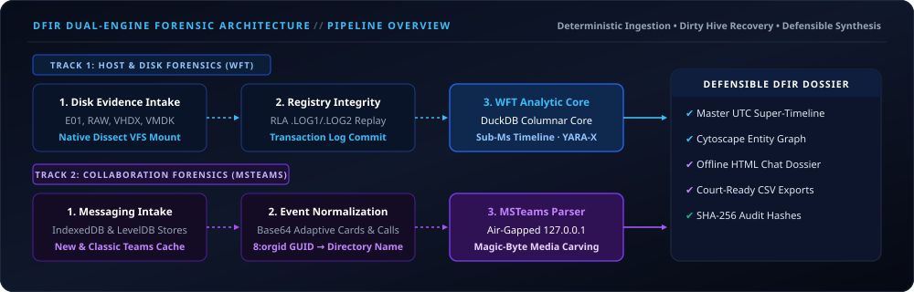

  

  
  
  
  

  

 

## Executive Profile

Digital Forensics &amp; Incident Response (**DFIR**) Analyst at **Tata Consultancy Services (TCS)**, specializing in enterprise Windows endpoint forensics, deep triage, cloud collaboration evidence, and end-to-end attack timeline reconstruction.

Forensic investigations routinely encounter critical failure points where standard commercial suites slow down or stop short—unflushed registry transactions locked in volatile `.LOG` files, high-volume event streams exceeding millions of rows, or undocumented IndexedDB and LevelDB messaging stores. My focus centers on building forensically sound, deterministic engines that ingest raw disk containers, replay transactions, and correlate cross-source telemetry into unshakeable, defensible chronologies.

| Domain | Technical Scope &amp; Forensic Focus |
| :--- | :--- |
| **Endpoint Forensics** | Windows 10 / 11 / Server · Disk containers (`.E01`, `.RAW`, `.VHDX`, `.VMDK`) · Low-level NTFS (`$MFT`, `$LogFile`, `$UsnJrnl`) |
| **Registry Integrity** | Automated dirty transaction log replay (`.LOG1` / `.LOG2` via RLA) · Multi-hive correlation (`SAM`, `SYSTEM`, `SOFTWARE`, `NTUSER`) |
| **Execution Triage** | PECmd (Prefetch) · AppCompatCache (Shimcache) · Amcache · UserAssist · BAM/DAM · SRUM metrics |
| **Collaboration &amp; Cloud** | Microsoft Teams (LevelDB/IndexedDB) · Discord · Slack · OneDrive sync database · Google Drive metadata |
| **Browser Forensics** | Chromium SQLite + WAL recovery (Chrome/Edge/Brave) · Firefox `places.sqlite` (PRTime conversion) |
| **Threat Hunting** | Compiled Rust YARA-X scanning · RapidOCR on carved artifacts · LOLBins &amp; webshell detection |
| **Analytical Stack** | Python 3.10+ · DuckDB Columnar Engine · FastAPI · React 18 / TypeScript · AG Grid · Cytoscape |

 

## DFIR Dual-Engine Architecture

  

 

## Flagship DFIR Workstations & Tooling

  
  

 

### 1. [WFT — Windows Forensic Examination Platform](https://github.com/sanjeeth-solleti/WFT)

An enterprise-grade Windows Digital Forensics and Incident Response platform engineered for comprehensive investigation (**Process + Examine**). WFT integrates virtual file system disk mounting, automated dirty registry transaction replay, external CLI toolchain orchestration, custom non-EZ parsers, YARA-X scanning, and RapidOCR into an unified analytics workstation.

- **Zero-Copy DuckDB Columnar Core:** In-process columnar analytical database delivering sub-millisecond queries, live multi-timestamp super-timelines unpivoted across all artifacts, and zero-latency filtering over 500,000+ forensic records.
- **Native Evidence Intake &amp; VFS:** Direct mounting and forensic extraction from `.E01`, `.Ex01`, `.VHDX`, `.VHD`, `.VMDK`, `.RAW`, `.DD`, and `.ISO` disk containers via native `dissect.target` VFS, as well as live triage folders.
- **Automated Registry Integrity:** Mandatory automated dirty registry transaction log replay (`.LOG1` / `.LOG2` via RLA) before hive analysis to ensure no unflushed forensic transactions are lost.
- **Full Eric Zimmerman Toolchain Orchestration:** Seamless batch processing with PECmd (Prefetch), MFTECmd ($MFT, $J, $LogFile), EvtxECmd (Event Logs), RECmd (Batch Registry), LECmd (LNK Shortcuts), JLECmd (Jump Lists), AmcacheParser, AppCompatCacheParser (Shimcache), SBECmd (ShellBags), SrumECmd (SRUM metrics), WxTCmd (ActivitiesCache), and SQLECmd.
- **Non-EZ Native Forensic Parsers:**
  - *Browsers:* Chromium (Chrome, Edge, Brave) and Firefox databases with full WAL recovery for History, Downloads, and Login Data.
  - *Collaboration:* Microsoft Teams, Discord, and Slack IndexedDB / LevelDB message parsing.
  - *Cloud Sync:* OneDrive (`SyncEngineDatabase.db`) and Google Drive synced metadata.
  - *USB Device Correlator:* Multi-hive correlation cross-referencing `setupapi.dev.log` with `SYSTEM` (`USBSTOR`, `MountedDevices`) and `SOFTWARE` (`EMDMgmt`) to reconstruct end-to-end device connection histories.
  - *Document &amp; MOTW Parser:* Metadata extraction with Mark-of-the-Web (`Zone.Identifier`) zone parsing.
- **Threat Hunting &amp; Inspection:** Rust-based compiled YARA-X rule engine scanning for webshells, beacons, and LOLBins, accompanied by RapidOCR text extraction from carved screenshots, receipts, and images.
- **Examiner UI:** Virtualized AG Grid with dynamic bookmarks, FTK Imager-style NTFS directory browser, interactive Cytoscape network entity graph linking IPs, binaries, and accounts, plus an integrated 16-byte dual Hex/ASCII inspector.

 

### 2. [MSTeams_Parser — Microsoft Teams DFIR Forensic Suite](https://github.com/sanjeeth-solleti/MSTeams_Parser)

A standalone DFIR suite engineered for parsing, reconstructing, and analyzing Microsoft Teams communication artifacts from raw forensic disk images and live triage extractions.

- **Air-Gapped Forensic Safety:** Embedded server binds strictly to `127.0.0.1`. Absolutely no data leaves the workstation, upholding forensic confidentiality.
- **Multi-Source Ingestion Pipeline:** Ingests New Teams (`%LOCALAPPDATA%\Packages\MSTeams_8wekyb3d8bbwe\...\IndexedDB`) and Classic Teams (`%APPDATA%\Microsoft\Teams\IndexedDB`), raw LevelDB files with `dfindexeddb` & `cramjam`, pre-parsed UTF-16 JSON dumps, and candidate CSV logs.
- **Message Normalization &amp; Event Parsing:** Unpacks raw XML/JSON markup into intelligible timelines: Base64 JSON Adaptive Cards, call started/ended events with participant lists and durations, meeting policy updates, member role changes, and file shares.
- **Identity &amp; Contact Resolution:** Resolves internal GUIDs (`8:orgid:<guid>`) to real employee names, emails, job roles, and corporate directory records.
- **Carving &amp; Telemetry Suppression:** Carves cached images and attachments, identifying file headers via magic bytes while automatically filtering UI telemetry, emojis, and noise (< 3.5 KB).
- **Examiner Reporting:** Standalone HTML chat viewer, Excel-ready CSV summaries (UTF-8 BOM), ZIP media bundle, audit log, and dual UTC/IST timestamps.

 

## Field Kit & Technical Arsenal

<table>
<tr><td width="22%"><b>Forensic Suites</b></td><td>

</td></tr>
<tr><td><b>Detection &amp; Hunting</b></td><td>

</td></tr>
<tr><td><b>Core Disciplines</b></td><td>

</td></tr>
<tr><td><b>Code &amp; Stack</b></td><td>

</td></tr>
</table>

 

## Defensible Forensic Standards

In DFIR, the defensibility of conclusions relies entirely on data integrity and process reproducibility. Every investigation and parser adheres to four core principles:

1. **Read-Only Ingestion:** Evidence is never mounted with write permissions. Forensic disk containers (`.E01`, `.RAW`, `.VHDX`) are mounted through read-only VFS virtual devices with strict write-blocking.
2. **Deterministic Transaction Replay:** Registry hives are never parsed "dirty" without replaying associated `.LOG1` and `.LOG2` transaction logs first, guaranteeing that pending system transactions are properly committed.
3. **Multi-Source Corroboration:** No artifact stands alone. Execution is verified across Prefetch, Shimcache, Amcache, and Event ID 4688/Sysmon 1 to construct unshakeable timelines.
4. **Cryptographic Defensibility:** SHA-256 cryptographic hashes are computed across original containers, carved assets, and exported reports to guarantee complete chain-of-custody defensibility.

 

---

  Open to technical discussions regarding digital forensics, artifact parser engineering, and incident response automation.  
  
  
  
    
  

