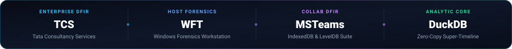
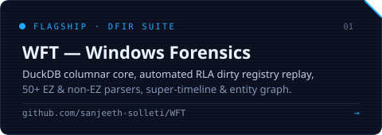
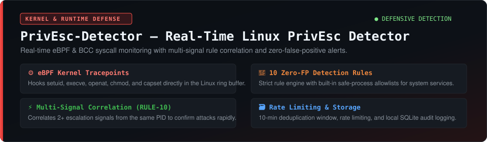

<p align="center">
  <a href="https://www.linkedin.com/in/sanjeeth-solleti/"></a>
  <a href="mailto:vasavasanjeeth@gmail.com"></a>
  <a href="https://github.com/sanjeeth-solleti?tab=repositories"></a>
  
</p>



<br>

## ▍whoami

Digital Forensics &amp; Incident Response (**DFIR**) Analyst specializing in enterprise Windows forensics, endpoint triage, cloud collaboration evidence, and attack-timeline reconstruction.

Forensic investigations often encounter edge cases—corrupted or unflushed transaction logs, undocumented application databases, and high-volume event streams where standard forensic suites slow down or leave questions unanswered. When off-the-shelf tools stop short, I build dedicated, forensically sound engines to extract, correlate, and validate every byte.

```yaml
endpoint_forensics:  Windows 10 / 11 / Server · E01 / RAW / VHDX / VMDK · NTFS ($MFT, $LogFile, $UsnJrnl)
registry_integrity:  Automated transaction log replay (RLA .LOG1/.LOG2) · Multi-hive correlation (SAM, SYSTEM, SOFTWARE, NTUSER)
execution_triage:    PECmd (Prefetch) · AppCompatCache (Shimcache) · Amcache · UserAssist · BAM/DAM · SRUM
messaging_&_cloud:   Microsoft Teams (LevelDB/IndexedDB) · Discord · Slack · OneDrive · Google Drive
browser_forensics:   Chromium SQLite + WAL recovery (Chrome/Edge/Brave) · Firefox places.sqlite (PRTime)
threat_hunting:      YARA-X compiled scanning · RapidOCR on carved media · LOLBins & webshell detection
development_stack:   Python 3.10+ · DuckDB Columnar Engine · FastAPI · React 18 / TypeScript · eBPF / BCC
```

<br>

## ▍Flagship DFIR Workstations &amp; Tooling

---

### 1. [WFT — Windows Forensic Examination Platform](https://github.com/sanjeeth-solleti/WFT)

<a href="https://github.com/sanjeeth-solleti/WFT">
  
</a>

<p align="center">
  <a href="https://github.com/sanjeeth-solleti/WFT"></a>
  <a href="https://github.com/sanjeeth-solleti/WFT"></a>
  <a href="https://github.com/sanjeeth-solleti/WFT"></a>
  <a href="https://github.com/sanjeeth-solleti/WFT"></a>
  <a href="https://github.com/sanjeeth-solleti/WFT"></a>
  <a href="https://github.com/sanjeeth-solleti/WFT"></a>
</p>

An enterprise-grade, full-featured Windows Digital Forensics and Incident Response workstation integrating evidence ingestion, virtual file system mounting, dirty registry log replay, external CLI orchestration, non-EZ forensic parsing, YARA-X scanning, and RapidOCR into an unified analytics platform.

- **Zero-Copy DuckDB Columnar Core:** In-process columnar database providing sub-millisecond queries, live multi-timestamp super-timelines unpivoted across all artifacts, and zero-latency filtering over 500,000+ records.
- **Native Evidence Intake &amp; VFS:** Direct mounting and forensic extraction from `.E01`, `.Ex01`, `.VHDX`, `.VHD`, `.VMDK`, `.RAW`, `.DD`, and `.ISO` disk containers via native `dissect.target` VFS, as well as live triage folders.
- **Automated Registry Integrity:** Mandatory automated dirty registry transaction log replay (`.LOG1` / `.LOG2` via RLA) before hive analysis to ensure no unflushed forensic transactions are lost.
- **Full Eric Zimmerman Toolchain Orchestration:** Seamless batch processing with PECmd (Prefetch), MFTECmd ($MFT, $J, $LogFile), EvtxECmd (Event Logs), RECmd (Batch Registry), LECmd (LNK Shortcuts), JLECmd (Jump Lists), AmcacheParser, AppCompatCacheParser (Shimcache), SBECmd (ShellBags), SrumECmd (SRUM metrics), WxTCmd (ActivitiesCache), and SQLECmd.
- **Non-EZ Native Forensic Parsers:**
  - *Browsers:* Chromium (Chrome, Edge, Brave) and Firefox databases with full WAL recovery for History, Downloads, and Login Data.
  - *Collaboration:* Microsoft Teams, Discord, and Slack IndexedDB / LevelDB message parsing.
  - *Cloud Sync:* OneDrive (`SyncEngineDatabase.db`) and Google Drive synced metadata.
  - *USB Device Correlator:* Multi-hive correlation cross-referencing `setupapi.dev.log` with `SYSTEM` (`USBSTOR`, `MountedDevices`) and `SOFTWARE` (`EMDMgmt`) to reconstruct end-to-end device connection histories.
  - *Document &amp; MOTW Parser:* Metadata extraction with Mark-of-the-Web (`Zone.Identifier`) zone parsing.
- **Threat Hunting &amp; Inspection:** Rust-based compiled YARA-X rule engine scanning for webshells, beacons, and LOLBins, accompanied by RapidOCR text extraction from carved screenshots, receipts, and images.
- **Examiner UI:** Virtualized AG Grid with dynamic bookmarks, interactive Cytoscape network entity graph linking IPs, binaries, and accounts, plus an integrated 16-byte dual Hex/ASCII inspector.

---

### 2. [MSTeams_Parser — Microsoft Teams Forensic Suite](https://github.com/sanjeeth-solleti/MSTeams_Parser)

<a href="https://github.com/sanjeeth-solleti/MSTeams_Parser">
  
</a>

<p align="center">
  <a href="https://github.com/sanjeeth-solleti/MSTeams_Parser"></a>
  <a href="https://github.com/sanjeeth-solleti/MSTeams_Parser"></a>
  <a href="https://github.com/sanjeeth-solleti/MSTeams_Parser"></a>
  <a href="https://github.com/sanjeeth-solleti/MSTeams_Parser"></a>
  <a href="https://github.com/sanjeeth-solleti/MSTeams_Parser"></a>
</p>

A standalone DFIR tool designed for parsing, reconstructing, and analyzing Microsoft Teams communication artifacts from forensic images and live triage extractions.

- **Air-Gapped Forensic Safety:** Embedded server binds strictly to `127.0.0.1`. Absolutely no data leaves the workstation, upholding forensic confidentiality.
- **Multi-Source Ingestion Pipeline:** Ingests New Teams (`%LOCALAPPDATA%\Packages\MSTeams_8wekyb3d8bbwe\...\IndexedDB`) and Classic Teams (`%APPDATA%\Microsoft\Teams\IndexedDB`), raw LevelDB files with `dfindexeddb`, pre-parsed UTF-16 JSON dumps, and candidate CSV logs.
- **Message Normalization &amp; Event Parsing:** Unpacks raw XML/JSON markup into intelligible timelines: Base64 JSON Adaptive Cards, call started/ended events with participant lists and durations, meeting policy updates, member role changes, and file shares.
- **Identity &amp; Contact Resolution:** Resolves internal GUIDs (`8:orgid:<guid>`) to real user names, emails, job roles, and corporate directory records.
- **Carving &amp; Telemetry Suppression:** Carves cached images and attachments, identifying file headers via magic bytes while automatically filtering UI telemetry, emojis, and noise (< 3.5 KB).
- **Examiner Reporting:** Standalone HTML chat viewer, Excel-ready CSV summaries, ZIP media bundle, audit log, and dual UTC/IST timestamps.

---

### 3. [PrivEsc-Detector — Real-Time Linux Privilege Escalation Detector](https://github.com/fuzzzer77/PrivEsc-Detector)



<p align="center">
  
  
  
  
</p>

Real-time, eBPF-based detection of Linux privilege-escalation attempts watching kernel syscalls and correlating events with strict zero-false-positive detection rules.

- **Kernel Tracepoints:** Attaches directly to `setuid`, `setreuid`, `setresuid`, `setgid`, `execve`, `openat`, `chmod`, and `capset` syscalls via eBPF ring buffers.
- **Rule Engine (RULE-01 to RULE-10):** Strict defensive rules equipped with process allowlists (`sudo`, `su`, `sshd`, `dpkg`/`apt`) to eliminate noise.
- **Multi-Signal Correlation:** RULE-10 detects 2+ distinct privilege-escalation signals emitted by the same PID within a 15-second window, flagging confirmed escalation bursts.
- **Audit Persistence:** Multi-threaded worker pool, 10-minute alert deduplication window, rate limiting, and local SQLite audit logging.

<br>

## ▍Forensic Artifact Coverage Matrix

A breakdown of critical Windows, messaging, and system artifacts parsed across my forensic tooling:

| Category | Forensic Artifact | File / Source Location | Evidentiary Value |
| :--- | :--- | :--- | :--- |
| **Execution** | **Prefetch** | `C:\Windows\Prefetch\*.pf` | Execution proof, run count, volume serial, previous execution timestamps |
| **Execution** | **Shimcache** | `SYSTEM\CurrentControlSet\Control\Session Manager\AppCompatCache` | Executable presence, path verification, last modified time |
| **Execution** | **Amcache** | `C:\Windows\appcompat\Programs\Amcache.hve` | SHA-1 program hashes, unassociated file entries, execution metadata |
| **Execution** | **SRUM** | `C:\Windows\System32\sru\SRUDB.dat` | Network bytes sent/received per application, background energy usage |
| **Execution** | **BAM / DAM** | `SYSTEM\CurrentControlSet\Services\bam` | Background Activity Moderator user execution timestamps |
| **Execution** | **UserAssist** | `NTUSER.DAT\Software\Microsoft\Windows\CurrentVersion\Explorer\UserAssist` | ROT13 encoded GUI application execution counts and last launch dates |
| **File System** | **NTFS $MFT** | `$MFT` (Root of volume) | File record attributes, $STANDARD_INFORMATION vs $FILE_NAME timestamp comparison (timestomp detection) |
| **File System** | **USN Journal** | `$Extend\$UsnJrnl:$J` | Complete record of file creation, modification, deletion, and renaming |
| **File System** | **ShellBags** | `USRCLASS.DAT` &amp; `NTUSER.DAT` | Folder browsing history, deleted directory verification, external drive reconnaissance |
| **File System** | **LNK &amp; Jump Lists** | `Recent\`, `AutomaticDestinations\`, `CustomDestinations\` | Target file path, creation/modification times, volume serial, MAC address |
| **System State** | **Registry Logs** | `*.LOG1`, `*.LOG2` transaction logs | Dirty hive recovery via RLA replay before static hive parsing |
| **System State** | **Event Logs** | `C:\Windows\System32\winevt\Logs\*.evtx` | Security (4624/4625, 4688), Sysmon (1, 3, 7, 10, 11), PowerShell (4104) |
| **Hardware** | **USB History** | `setupapi.dev.log`, `SYSTEM\USBSTOR`, `SOFTWARE\EMDMgmt` | First/last connection times, device serial numbers, volume labels |
| **Messaging** | **Microsoft Teams** | `IndexedDB` &amp; `LevelDB` stores | Reconstructed chat messages, Base64 Adaptive Cards, calls, meetings, carved media |
| **Browsers** | **Chromium &amp; Firefox** | `History`, `Downloads`, `places.sqlite` | SQLite + WAL recovery, full-text URL search, PRTime timestamp normalization |
| **Network/Cloud**| **Cloud Sync** | OneDrive (`SyncEngineDatabase.db`), Google Drive | Synchronized file paths, cloud sync status, account identities |

<br>

## ▍Field Kit &amp; Arsenal

<table>
<tr><td width="22%"><b>Forensic Suites</b></td><td>


</td></tr>
<tr><td><b>Detection &amp; Hunting</b></td><td>


</td></tr>
<tr><td><b>Core Disciplines</b></td><td>


</td></tr>
<tr><td><b>Code &amp; Stack</b></td><td>


</td></tr>
</table>

<br>

## ▍Investigative Principles &amp; Evidence Handling

In DFIR, the validity of conclusions relies entirely on the integrity of the data and the reproducibility of the extraction process. Every tool and investigation adheres to four fundamental principles:

1. **Read-Only Ingestion:** Evidence is never mounted with write permissions. Forensic disk containers (`.E01`, `.RAW`, `.VHDX`) are mounted through read-only VFS virtual devices with strict write-blocking.
2. **Deterministic Transaction Replay:** Registry hives are never parsed "dirty" without replaying associated `.LOG1` and `.LOG2` transaction logs first, guaranteeing that pending system transactions are properly committed.
3. **Multi-Source Corroboration:** No artifact stands alone. A process launch is verified across Prefetch, Shimcache, Amcache, and Event ID 4688/Sysmon 1 to build unshakeable timelines.
4. **Cryptographic Validation:** SHA-256 cryptographic hashes are computed across original containers, carved assets, and exported reports to guarantee complete chain-of-custody defensibility.

<br>

## ▍Credentials &amp; Certifications


<br>

---

<p align="center">
  <sub>Open to conversations regarding digital forensics, artifact parser development, and incident response automation.</sub><br><br>
  <a href="https://www.linkedin.com/in/sanjeeth-solleti/"></a>
  <a href="mailto:vasavasanjeeth@gmail.com"></a>
  <a href="https://github.com/sanjeeth-solleti?tab=repositories"></a>
  <br><br>
  
</p>
